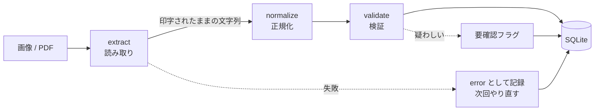

# receipt-normalizer

[](https://github.com/swatanabe-0/receipt-normalizer/actions/workflows/ci.yml)

**形式の異なるレシート画像を、共通のスキーマに正規化して、SQLite に取り込む**最小構成のサンプルです。

OCR（Gemini API）で読み取り、日付や金額の書き方の揺れを統一し、疑わしいものには「要確認」の印を付け、同じファイルを二重に登録しない、という一連の流れを、小さなコードで示しています。

> **このリポジトリについて**
> ポートフォリオ用に、ゼロから書いたサンプルです。実在の店・データ・業務のコードは、一切含みません。
> サンプル画像の店名・品目は、すべて架空のものです。

## 解決したい課題

発行元ごとに、書式がバラバラな帳票を、1つのデータベースにまとめたい。

| 揺れの例      | レシートでの現れ方                                         |
| ------------- | ---------------------------------------------------------- |
| 日付の書式    | `2025/03/07` / `令和7年3月8日(土)` / `R7.3.9` / `2025-03-11` |
| 数字の書式    | `¥1,280` / `1,060円` / `２１０`（全角）/ `▲¥ 100`（値引き） |
| 税の扱い      | 内税（明細に含む）/ 外税（小計 + 消費税 = 合計）            |
| レイアウト    | 日本語 / 英字 / 表形式 / 項目の有無                         |
| 読み取りの誤り | 値引き行の読み落とし、日付が切れている                      |

## 設計方針

形式ごとのテンプレートを作る方式は、形式が増えるたびに破綻します。そこで、次の方針にしています。

| 方針                                     | 理由                                                                                                         |
| ---------------------------------------- | ------------------------------------------------------------------------------------------------------------ |
| **モデルには「読み取り」だけを任せる**   | 日付や金額の変換まで任せると、結果がぶれて、テストもできない                                                 |
| **変換は、コードで決定的に行う**         | 書き方の揺れへの対応を、テストで確かめながら増やせる（`normalize.py`）                                       |
| **共通のスキーマを先に決める**           | 形式ごとの分岐を作らずに、スキーマに合わせて出力させる（`schema.py`）                                        |
| **疑わしいものは、黙って取り込まない**   | 「明細の合計と合計金額が合わない」などを検出して、要確認の印を付ける（`validate.py`）                        |
| **読み取り結果を、そのまま残す**         | あとから、変換や検証が正しかったかを確かめられる（`raw_json`）                                               |
| **同じ入力で、何度実行しても同じ結果**   | ファイルの内容のハッシュで重複を判定し、再実行しても二重登録しない（`store.py`）                             |
| **1件の失敗で、全体を止めない**          | 失敗は記録して次へ進み、次回の実行でやり直す（`pipeline.py`）                                                |
| **読み取り方法を差し替えられる**         | `Extractor` という小さな約束事にして、API キー無しでも全体を動かせる・テストできる（`extract.py`）           |

## 構成



```
src/receipt_normalizer/
  schema.py     データの型（読み取り結果 / 正規化後）
  extract.py    読み取り（GeminiExtractor / FixtureExtractor）
  normalize.py  日付・金額・数量の正規化
  validate.py   検証ルール（要確認フラグ）
  store.py      SQLite への保存、集計
  pipeline.py   取り込みの流れ（1ファイル単位）
  cli.py        コマンドライン
scripts/
  generate_samples.py   ダミーのレシート画像の生成
samples/receipts/       生成済みのサンプル（画像と、読み取り結果の JSON）
tests/                  テスト（API キー不要）
```

## 使い方

### 1. セットアップ

Python 3.11 以上が必要です。

```bash
python -m venv .venv
.venv\Scripts\activate        # macOS / Linux は: source .venv/bin/activate
pip install -e ".[dev]"
```

### 2. API キー無しで、動作を確かめる

`--extractor fixture` は、画像の隣にある `*.raw.json`（読み取り結果）を使います。取り込みの流れ全体を、API 無しで試せます。

```bash
receipt-normalizer ingest samples/receipts --db demo.db --extractor fixture
receipt-normalizer report --db demo.db
```

実行結果の例です。

```
[ok     ] receipt_01_bakery.png
[ok     ] receipt_02_stationery.png
...
[review ] receipt_06_bento.png  TOTAL_MISMATCH
[review ] receipt_07_florist.png  NO_DATE
[skip   ] receipt_08_duplicate.png
[error  ] receipt_09_unreadable.png  読み取り結果の JSON がありません: ...

完了: 9 件  (error=1  needs_review=2  ok=5  skipped=1)
```

もう一度実行すると、取り込み済みのものは `skip` になり、二重には登録されません（失敗した1件だけが、やり直されます）。

### 3. Gemini API で、実際に読み取る

```bash
# Windows (PowerShell)
$env:GEMINI_API_KEY = "（取得した API キー）"
# macOS / Linux
export GEMINI_API_KEY="（取得した API キー）"

receipt-normalizer ingest path/to/images --db receipts.db --min-interval 13
```

- API キーは、環境変数で渡します。コードやリポジトリには、含めません（`.env` は `.gitignore` 済み）。
- 使うモデルは、環境変数 `GEMINI_MODEL` で変えられます（既定：`gemini-3.8-flash`）。**モデルは入れ替わるため、「利用できません（404）」と出たら、使えるモデルを指定してください。**
- `--min-interval` は、読み取りの間隔（秒）です。無料枠は「1分に5回」程度の制限があるため、`13` などを指定すると、制限に当たりません。指定しなくても、制限に当たった場合は、サーバーが示す時間だけ待って、再試行します。
- モデルが存在しない・キーが無効といった設定の問題は、全ファイルで同じ理由で失敗するため、再試行せずに、すぐに中断して原因を表示します。

## サンプルの内容

`samples/receipts/` には、形式と状況の異なるダミーのレシートがあります。`scripts/generate_samples.py` で作り直せます。

| ファイル                  | 内容                                                  | 結果       |
| ------------------------- | ----------------------------------------------------- | ---------- |
| `receipt_01_bakery`       | 内税、`2025/03/07 12:34`、`¥` 表記                    | ok         |
| `receipt_02_stationery`   | 和暦 `令和7年3月8日`、`円` 表記                       | ok         |
| `receipt_03_grocery`      | `R7.3.9`、全角数字                                    | ok         |
| `receipt_04_cafe`         | 外税（小計 + 消費税 = 合計）、`×2` の数量             | ok         |
| `receipt_05_drugstore`    | 英字表記、通貨記号なし                                | ok         |
| `receipt_06_bento`        | 値引き行を読み落とした（明細の合計 ≠ 合計金額）       | 要確認     |
| `receipt_07_florist`      | 日付が切れていて読めない                              | 要確認     |
| `receipt_08_duplicate`    | `receipt_01` と同じファイル                           | スキップ   |
| `receipt_09_unreadable`   | 読み取れない画像（読み取り結果なし）                  | エラー     |

## テスト

```bash
pytest          # API キーは不要。読み取りは、モックで置き換えている
ruff check .    # 静的チェック
ruff format --check .
```

主な確認内容は次の通りです。

- 日付・金額の書式の揺れの変換（和暦、全角、符号の付き方など）
- 検証ルール（内税 / 外税、値引き、未来の日付など）
- 読み取り API の再試行（一時的な失敗、不正な JSON、上限回数）
- 取り込みの冪等性、失敗したファイルのやり直し

GitHub Actions で、push のたびに自動実行しています。

## 実際の API で試して、分かったこと

モックのテストだけでは見つからなかった問題が、実際に API を呼んで、見つかりました。

| 見つかったこと | 原因 | 対応 |
| --- | --- | --- |
| 合計が `890` 円のレシートが、**`8` 円で「正常」として取り込まれた** | 字間の広い数字を、モデルが `8 9 0` のように空白で区切って返した。先頭の `8` だけを読んでいた。明細も同様に誤読し、**合計と偶然一致して、検証を通り抜けた** | 1桁ずつ区切られた数字は、つなげて読む。さらに、**読み取った数のほかに数字が残る金額は、推測せず「読み取れない」として要確認にする**（`tests/test_real_world_regressions.py`） |
| 6件目以降が、`429 RESOURCE_EXHAUSTED` で失敗 | 無料枠の、1分あたりの回数制限。再試行の間隔（1〜2秒）が、約60秒の制限に足りなかった | サーバーが示す待ち時間に従う。呼び出しの間隔をあける `--min-interval` を追加 |
| `404 NOT_FOUND`（モデルが利用できない）が、全ファイルで3回ずつ再試行され、9件の「失敗」として記録された | 既定のモデルが、新規ユーザーには提供されなくなっていた | 認証・権限・モデルの問題は、再試行せずに中断して、原因と直し方を表示 |
| `503 UNAVAILABLE`（負荷の集中）で、1件が失敗 | 再試行の間隔（1〜2秒）が、サーバー側の不調の回復に足りなかった | サーバー側の不調（5xx）は、5秒 → 15秒 と、長めに待って再試行 |
| `429` が、**1日の上限**で出た（`retry in 17h44m`）。90秒待って再試行しても、無駄だった | 無料枠には、1分あたりの制限のほかに、**1日あたりの制限**がある | 待ち時間が10分を超えるときは、上限に達したと判断して、すぐに中断。いつ再開できるかと、別のモデルを使う方法を表示 |

特に1つ目は、「**間違いが、一貫した形で起きると、整合性の検証では見つからない**」という例です。検証ルールを足すだけでなく、**変換の段階で、曖昧な入力を採用しない**ことが重要だと分かりました。

### 動作確認の結果

ダミーのレシート6枚を、実際の API で読み取り、正規化した結果は、画像の内容と、**6件すべてで一致**しました。

| 画像 | 確認できたこと |
| --- | --- |
| `01`〜`05` | 和暦・全角数字・外税・英字表記を含む5形式を、正しく共通のスキーマに変換できた |
| `06` | **値引き行（`▲¥ 100`）も、符号つきで読み取れた**（合計 980 円と、明細の合計が一致） |

なお、`06` は、サンプルの読み取り結果（`*.raw.json`）では「値引き行を読み落とした」想定にしていますが、実際のモデルは、読み落としませんでした。「要確認」の流れは、`--extractor fixture` で確認できます。

ただし、次の点に注意してください。

- 対象は、きれいに生成した**架空の画像**で、枚数も少数です。実際の撮影画像（傾き、影、折れ、手書き）での精度は、評価していません。
- `07`（日付が切れている画像）と、`09`（白紙の画像）は、サーバーの不調と、無料枠の1日の上限により、**実際の API での評価が済んでいません**。上限が回復したら、追記します。

## 制限と、今後の課題

正直に書いておきます。

- **実際の撮影画像での読み取り精度は、評価していません。** 上の結果は、少数の、きれいな架空画像に対するものです。精度は、画像の品質とモデルによって変わります。
- 重複の判定は、**ファイルの内容が完全に同じ**場合だけです。同じレシートを、別に撮影した場合は、別物として扱います。
- 金額は、**円（整数）** だけを扱います。外貨や、小数点以下は扱いません。
- 保存先は SQLite です。実運用では、RDB への置き換えや、要確認データの確認画面が必要です。
- 税率ごとの内訳（8% と 10%）は、保存していません。
